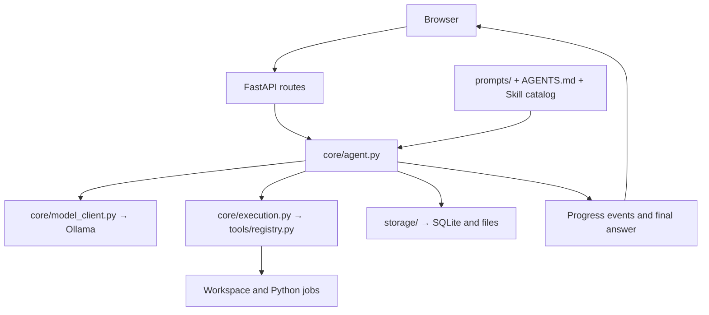

# Architecture

[繁體中文](architecture.md) · [Home](../README.en.md)

## Responsibilities

| Layer | Responsibility | Outside its responsibility |
| --- | --- | --- |
| `core/` | Models, tools, modes, pause control, and conclusions | Web route implementation |
| `tools/` | Functions, schemas, and strict argument validation | The model loop |
| `storage/` | Conversations, memory, files, and process state | Choosing the model's answer |
| `web/` | APIs, SSE, and the user interface | Treating interim text as a final answer |

## A conversation run

1. The frontend sends the message, mode, reasoning level, and image IDs. The API creates run control.
2. The Agent selects the current workspace and context, updating L2 or compacting history when needed.
3. Automatic mode chooses direct execution or planning. Explicit planning starts SDD directly.
4. Each round assembles system prompts, shared/workspace preferences, the Skill catalog, and available tool schemas.
5. The model selects tools. The executor validates arguments, calls functions, and logs results.
6. `finish_task` or successful planning produces the final `answer`. Interim text is emitted as `progress` and shown in collapsed activity.
7. Conversation and working context are saved, followed by project memory updates. An unfinished run gets one tool-free summary after AGENT_MAX_STEPS rounds (default 15).

## Memory and data

- **Conversation history:** `memory.db` stores messages, projects, and image references.
- **Working context:** `context_manager.py` persists it. Output allowance is reserved first; compaction starts at 80% of the remaining input budget.
- **L2:** Incremental summaries per project. Standalone conversations do not share L2. User-pinned content is separate from automatic summaries.
- **Original records:** Pre-compaction context and long tool outputs are stored in `data/`; original conversations are retained.
- **Execution logs:** Stored per project/conversation under `logs/`; successful status queries are filtered.

Workspaces use `workspace/projects/<project_id>/` or `workspace/conversations/<session_id>/`. Root `AGENTS.md` contains shared preferences; only the current workspace's additional `AGENTS.md` is loaded.

## Extensions

- Tools: define a typed function under `app/tools/` and register it in `app/tools/__init__.py`. Schemas and validation use the same signature.
- Prompts: store them in `prompts/` and assemble them in `core/prompt.py`, rather than embedding long strings in the task loop.
- Skills: install locally under `skills/<name>/SKILL.md`. Start with the opening lines and heading index, then select necessary ranges. Loading a Skill does not execute its scripts.

These boundaries do not provide multi-user authorization or an operating-system sandbox. Directory READMEs contain the file index.
