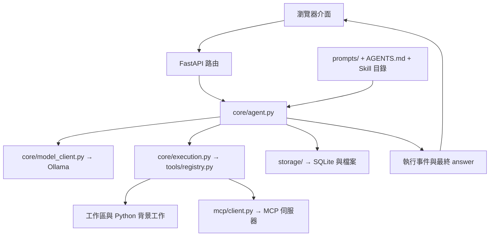

# 架構說明

[English](architecture.en.md) · [首頁](../README.md)

## 分工

| 層 | 做什麼 | 不負責什麼 |
| --- | --- | --- |
| `core/` | 協調模型、工具、模式、暫停與結案 | 不直接實作網頁路由 |
| `tools/` | 定義函式、Schema 與嚴格參數驗證 | 不自行管理模型循環 |
| `mcp/` | 外部工具連線、綁定與回傳轉換 | 不取代 Blender 或其插件 |
| `storage/` | 對話、記憶、檔案與程序狀態 | 不決定模型的回答內容 |
| `web/` | API、SSE 與使用介面 | 不把中途文字當成最終答案 |

## 一次對話

1. 前端送出訊息、模式、思考程度與圖片 ID；API 建立執行控制。
2. Agent 取得目前專案／對話的工作區及上下文；需要時更新 L2 或壓縮歷史。
3. 自動模式判斷直接執行或規劃；手動規劃直接進入 SDD。
4. 每輪重新組裝系統提示、共用／工作區偏好、Skill 目錄與可用工具 Schema。
5. 模型選擇工具；執行器驗證參數、呼叫函式並記錄結果。MCP 工具只對目前綁定範圍開放。
6. `finish_task` 或成功的規劃流程產生最終 `answer`；中途文字為 `progress`，放在收合紀錄。
7. 保存對話與工作上下文，更新專案記憶。15 輪未結案時，再做一次不開放工具的統整。

## 記憶與資料

- **對話紀錄**：`memory.db` 保存訊息、專案與圖片引用。
- **工作上下文**：由 `context_manager.py` 保存；總上下文扣除輸出預留，再以 80% 為壓縮門檻。
- **L2**：各專案的增量摘要；一般對話不共用 L2。使用者固定內容與自動摘要分開。
- **原文**：壓縮前上下文與長工具輸出保存在 `data/`，不覆蓋原始對話。
- **執行紀錄**：依專案／對話分流到 `logs/`；成功狀態查詢不重複寫入。

工作區位於 `workspace/projects/<project_id>/` 或 `workspace/conversations/<session_id>/`。根目錄 `AGENTS.md` 是共用偏好；只額外讀目前工作區的 `AGENTS.md`。

## 擴充

- 新增工具：在 `app/tools/` 定義帶型別的函式，於 `app/tools/__init__.py` 註冊；Schema 與驗證沿用同一簽名。
- 新增提示：放在 `prompts/`，由 `core/prompt.py` 組裝，不把整段文字塞入主循環。
- 安裝 Skill：放在本機 `skills/<name>/SKILL.md`；參考檔按需讀取，不自動執行 Skill 內的腳本。
- 連接 MCP：在本機 `mcp.json` 設定 command 或 url；敏感值透過環境變數引用。通用程式留在 `app/mcp/`。

這些是應用程式的邊界，不是多使用者或作業系統安全隔離。完整檔案索引見各資料夾的 README。
